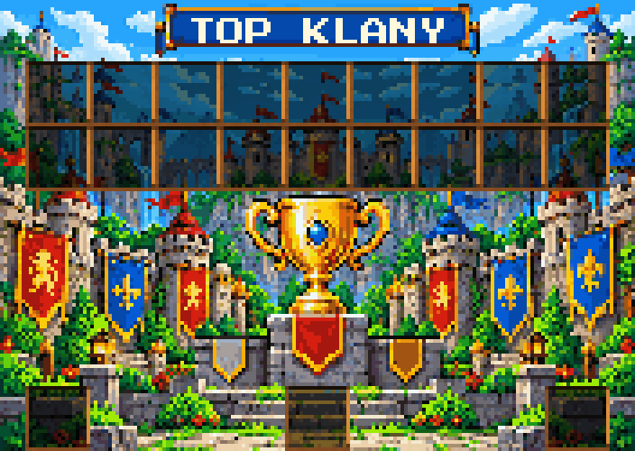
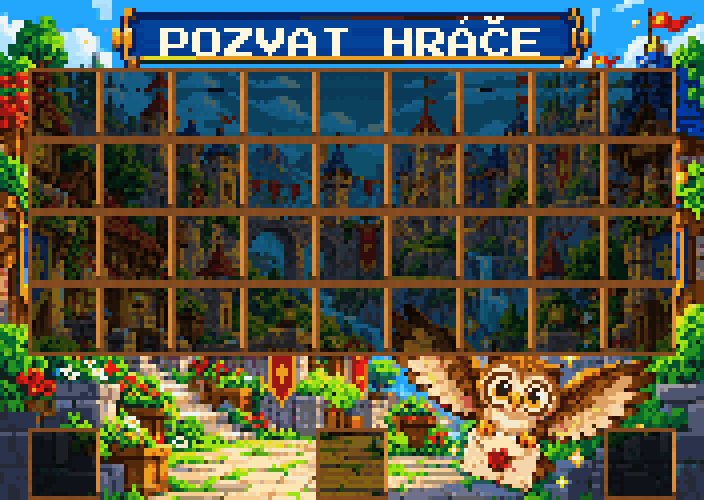
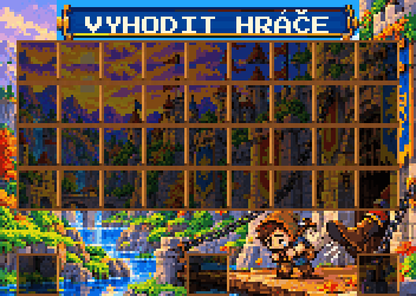
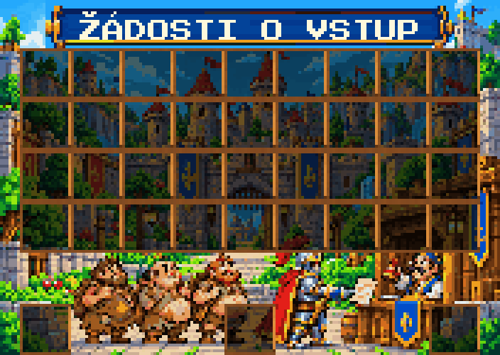
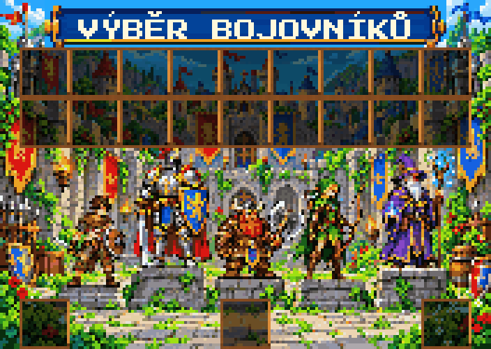
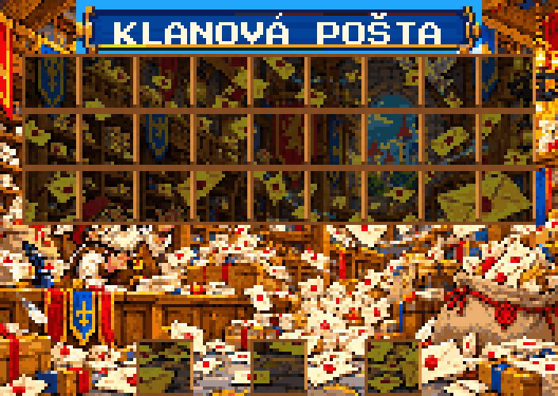
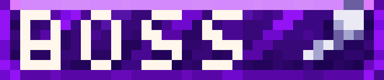

# Dungeons GUI

Grafika pro Minecraft GUI v rozměru **176 × 112 px**. Nahoře LICH a ORK, dole MURLOC a BANDITI.

- [Otevřít PNG](dungeons_gui_176x112.png)
- [Otevřít SVG](dungeons_gui_176x112.svg)

Pro stažení otevři soubor a použij tlačítko **Download raw file** vpravo nahoře.

## Rank NINJA — 55 × 14 px

Červená ranková ikonka vyplňuje celých **55 × 14 px** bez průhledného odsazení. Má vzorované pozadí, větší čitelný nápis **NINJA** a bílý latinský kříž s delší spodní částí vpravo.

Náhled výše je zvětšený pro snadné prohlížení. Pro použití ve hře stáhni originál:

- [PNG — originál 55 × 14 px](ninja_rank_55x14.png)
- [SVG — 55 × 14 px](ninja_rank_55x14.svg)
- [Zvětšený PNG náhled](ninja_rank_preview.png)

## DREAM SHOP — 176 × 112 px

Minecraft GUI vyplňuje celých **176 × 112 px**. Má šedý rámeček, horní lištu **DREAM SHOP**, rozostřené barevné pozadí, zlatou minci vlevo dole a šest slotů vpravo ve dvou sloupcích a třech řádcích.

- [PNG — originál 176 × 112 px](dream_shop_gui_176x112.png)
- [Zvětšený PNG náhled](dream_shop_gui_preview.png)

## SKLADIŠTĚ — 54 slotů, 176 × 112 px

Panel má přesně **176 × 112 px**, vyplňuje celou plochu a obsahuje **54 slotů v 6 řadách po 9**. Uvnitř obrázku není nadpis. Sloty mají rozteč **18 px** a vnitřní prostor **16 × 16 px** pro item.

Pro standardní souřadnice Minecraft menu se při měřítku **1:1** počítá umístění levého horního rohu obrázku na **(0, +15)** vzhledem k levému hornímu rohu menu. Skutečné zarovnání závisí na vykreslení v použitém menu/font pluginu; ve hře zatím nebylo ověřeno.

- [PNG — originál 176 × 112 px](skladiste_gui_176x112.png)
- [Zvětšený PNG náhled](skladiste_gui_preview.png)
- [Přesné souřadnice všech slotů (JSON)](skladiste_slot_layout.json)
- [Pokyny pro zarovnání v menu](skladiste_alignment.md)

## SKLADIŠTĚ s poličkami — horní panel 176 × 125 px

Horní panel zachovává **54 slotů v 6 řadách po 9** na standardních souřadnicích šablony. Dřevěné poličky tvoří rámečky slotů; hráčův inventář do obrázku není zahrnutý. Rozměr **176 × 125 px** odpovídá horní části šestiřadého chest menu: 17 px horní lišty a 108 px mřížky. Sloty mají přesnou rozteč **18 px** a prostor **16 × 16 px** pro každý item.

Nadpis **SKLADIŠTĚ** je vysázen ostrým pixelovým písmem s českými háčky. Poličky a souřadnice všech slotů zůstaly zachované.

- [PNG — horní panel 176 × 125 px](skladiste_policky_176x125.png)
- [Zvětšený PNG náhled](skladiste_policky_preview.png)
- [Přesné souřadnice slotů (JSON)](skladiste_policky_slot_layout.json)

Starší kompaktní varianta 176 × 112 px zůstává dostupná výše. Zarovnání nové varianty přímo ve hře zatím nebylo ověřeno.

Pro tuto variantu s horní lištou při standardním bitmapovém vykreslení použij `scale_ratio: 125`, `y_position: 13` a titulek `&f爩`. Cílem je vykreslení 1:1 s levým horním rohem obrázku na `(0, 0)` vůči menu. Hodnota `y_position` předpokládá přímé mapování na fontový ascent; skutečné zarovnání na serveru zatím nebylo ověřeno.

## KLANY — cartoon GUI 176 × 125 px

Celou plochu **176 × 125 px** vyplňuje cartoon pixelartová ilustrace klanové osady s pevností a ostrým pixelovým nadpisem **KLANY**. Menu má kapacitu **54 slotů (9 × 6)**, ale nakreslené rámečky jsou pouze u **11 používaných slotů**: **1, 3, 4, 5, 7, 19, 22, 25, 37, 40 a 43**. Číslování začíná od nuly; ostatní plocha tvoří souvislou kresbu. Hráčův inventář není součástí obrázku.

Rámečky zachovávají standardní souřadnice, rozteč **18 px** a prostor **16 × 16 px** pro každý item, stejně jako skladiště s poličkami.

- [PNG — originál 176 × 125 px](klany_gui_176x125.png)
- [Zvětšený PNG náhled](klany_gui_preview.png)
- [Přesné souřadnice slotů (JSON)](klany_slot_layout.json)
- [Samotná ilustrace bez rámečků](klany_pozadi_176x125.png)

V ItemsAdder přiřaď novému obrázku vlastní fontový znak. Zarovnání přímo ve hře zatím nebylo ověřeno.

## TOP KLANY — cartoon pixel art 176 × 125 px

Celoplošná cartoon pixelartová ilustrace pro podmenu **TOP KLANY** má motiv poháru, hradů a stupňů vítězů. Panel má stejný rozměr **176 × 125 px** a stejné souřadnice jako hlavní klanové GUI. Hráčův inventář není součástí obrázku.

Rámečky jsou pouze u **21 používaných slotů**: **0–17** pro hlavy klanů a **45, 49 a 53** pro navigaci. Hlavy, šipky ani ikona domů nejsou do obrázku nakreslené; zobrazuje je menu plugin. Sloty zachovávají rozteč **18 px** a vnitřní prostor **16 × 16 px** pro item.

Číslování začíná od nuly, takže poslední slot šestiřadého menu je **53**. Pozice pravé šipky zadaná jako 54 je proto připravená v pravém dolním rohu na indexu **53**.

- [PNG — originál 176 × 125 px](top_klany_gui_176x125.png)
- [Zvětšený PNG náhled](top_klany_gui_preview.png)
- [Přesné souřadnice slotů (JSON)](top_klany_slot_layout.json)
- [Samotná ilustrace bez rámečků](top_klany_pozadi_176x125.png)

V ItemsAdder přiřaď novému obrázku vlastní fontový znak. Zarovnání přímo ve hře zatím nebylo ověřeno.

## POZVAT HRÁČE — cartoon pixel art 176 × 125 px

Celoplošná cartoon pixelartová ilustrace pro klanové podmenu **POZVAT HRÁČE** má motiv sovy nesoucí zapečetěný dopis a klanového hradu. Panel má stejný rozměr **176 × 125 px** a stejné souřadnice jako ostatní klanová GUI. Hráčův inventář není součástí obrázku. Sova má zvýrazněné oči a všechny rámečky souvislou hnědou horní hranu.

Rámečky jsou pouze u **39 používaných slotů**: **0–35** pro hráče a **45, 49 a 53** pro navigaci. Hlavy hráčů, šipky ani ikona domů nejsou do obrázku nakreslené; zobrazuje je menu plugin. Sloty zachovávají rozteč **18 px** a vnitřní prostor **16 × 16 px** pro item.

Číslování začíná od nuly, takže poslední slot šestiřadého menu je **53**. Pozice pravé šipky zadaná jako 54 je proto připravená v pravém dolním rohu na indexu **53**.

- [PNG — originál 176 × 125 px](pozvat_hrace_gui_176x125.png)
- [Zvětšený PNG náhled](pozvat_hrace_gui_preview.png)
- [Přesné souřadnice slotů (JSON)](pozvat_hrace_slot_layout.json)
- [Samotná ilustrace bez rámečků](pozvat_hrace_pozadi_176x125.png)

V ItemsAdder přiřaď novému obrázku vlastní fontový znak. Zarovnání přímo ve hře zatím nebylo ověřeno.

## VYHODIT HRÁČE — cartoon pixel art 176 × 125 px

Celoplošná cartoon pixelartová ilustrace pro klanové podmenu **VYHODIT HRÁČE** zobrazuje smutného vyhozeného člena, komicky velkou botu a padací most hradu. Scénka s motivem žalu a lítosti je kreslená s nadsázkou. Panel má stejný rozměr **176 × 125 px** a stejné souřadnice jako ostatní klanová GUI. Hráčův inventář není součástí obrázku.

Rámečky se souvislými hnědými horními hranami jsou pouze u **39 používaných slotů**: **0–35** pro hráče a **45, 49 a 53** pro navigaci. Hlavy hráčů, šipky ani ikona domů nejsou do obrázku nakreslené; zobrazuje je menu plugin. Sloty zachovávají rozteč **18 px** a vnitřní prostor **16 × 16 px** pro item.

Číslování začíná od nuly, takže poslední slot šestiřadého menu je **53**. Pozice pravé šipky zadaná jako 54 je proto připravená v pravém dolním rohu na indexu **53**.

- [PNG — originál 176 × 125 px](vyhodit_hrace_gui_176x125.png)
- [Zvětšený PNG náhled](vyhodit_hrace_gui_preview.png)
- [Přesné souřadnice slotů (JSON)](vyhodit_hrace_slot_layout.json)
- [Samotná ilustrace bez rámečků](vyhodit_hrace_pozadi_176x125.png)

V ItemsAdder přiřaď novému obrázku vlastní fontový znak. Zarovnání přímo ve hře zatím nebylo ověřeno.

## ŽÁDOSTI O VSTUP — cartoon pixel art 176 × 125 px

Celoplošná cartoon pixelartová ilustrace pro klanové podmenu **ŽÁDOSTI O VSTUP** zobrazuje větší a detailnější frontu tří zavalitých chlapíků v potrhaném hnědém oblečení; každý drží v ruce vlastní papír. Vpředu stojí hrdinský rytíř, který podává další papír moudrému starci s razítkem v budce u hradní brány. Panel má stejný rozměr **176 × 125 px** a stejné souřadnice jako ostatní klanová GUI. Hráčův inventář není součástí obrázku.

Rámečky se souvislými hnědými horními hranami jsou pouze u **21 používaných slotů**: **0–17** pro hráče a **45, 49 a 53** pro navigaci. Hlavy hráčů, šipky ani ikona domů nejsou do obrázku nakreslené; zobrazuje je menu plugin. Pozice **18–35** tvoří souvislou ilustraci bez mřížek, aby postavy lépe vynikly. Sloty zachovávají rozteč **18 px** a vnitřní prostor **16 × 16 px** pro item.

Číslování začíná od nuly, takže poslední slot šestiřadého menu je **53**. Pozice pravé šipky zadaná jako 54 je proto připravená v pravém dolním rohu na indexu **53**.

- [PNG — originál 176 × 125 px](zadosti_o_vstup_gui_176x125.png)
- [Zvětšený PNG náhled](zadosti_o_vstup_gui_preview.png)
- [Přesné souřadnice slotů (JSON)](zadosti_o_vstup_slot_layout.json)
- [Samotná ilustrace bez rámečků](zadosti_o_vstup_pozadi_176x125.png)

V ItemsAdder přiřaď novému obrázku vlastní fontový znak. Zarovnání přímo ve hře zatím nebylo ověřeno.

## VÝBĚR BOJOVNÍKŮ — cartoon pixel art 176 × 125 px

Celoplošná cartoon pixelartová ilustrace pro klanové podmenu **VÝBĚR BOJOVNÍKŮ** zobrazuje pět různých bojovníků připravených na clan wars na různě vysokých kamenných stupíncích: chudého otrhaného nováčka, elitního rytíře ve stříbrné a zlaté zbroji, vousatého trpaslíka se sekerou, zeleného elfího lučištníka a fialového mága s holí. Panel má stejný rozměr **176 × 125 px** a stejné souřadnice jako ostatní klanová GUI. Hráčův inventář není součástí obrázku.

Rámečky se souvislými hnědými horními hranami jsou pouze u **21 používaných slotů**: **0–17** pro **18 hráčů** a **45, 49 a 53** pro navigaci. Hlavy hráčů, šipky ani ikona domů nejsou do obrázku nakreslené; zobrazuje je menu plugin. Ostatní plocha tvoří souvislou ilustraci. Sloty zachovávají rozteč **18 px** a vnitřní prostor **16 × 16 px** pro item.

Číslování začíná od nuly, takže poslední slot šestiřadého menu je **53**. Pozice pravé šipky zadaná jako 54 je proto připravená v pravém dolním rohu na indexu **53**.

- [PNG — originál 176 × 125 px](vyber_bojovniku_gui_176x125.png)
- [Zvětšený PNG náhled](vyber_bojovniku_gui_preview.png)
- [Přesné souřadnice slotů (JSON)](vyber_bojovniku_slot_layout.json)
- [Samotná ilustrace bez rámečků](vyber_bojovniku_pozadi_176x125.png)

V ItemsAdder přiřaď novému obrázku vlastní fontový znak. Zarovnání přímo ve hře zatím nebylo ověřeno.

## KLANOVÁ POŠTA — cartoon pixel art 176 × 125 px

Celoplošná cartoon pixelartová ilustrace pro klanové podmenu **KLANOVÁ POŠTA** zobrazuje rušnou fantasy poštu s hromadami dopisů, obálkami poletujícími vzduchem a zásilkami rozházenými na podlaze. Panel má stejný rozměr **176 × 125 px** a stejné souřadnice jako ostatní klanová GUI. Hráčův inventář není součástí obrázku.

Rámečky se souvislými hnědými horními hranami jsou pouze u **30 používaných slotů**: **0–26** pro **27 zpráv** a **47, 49 a 51** pro navigaci. Číslování začíná od nuly. Slot **47** je předchozí stránka, **49** další stránka a **51** návrat domů. Šipky ani ikona domů nejsou do obrázku nakreslené; obsah slotů zobrazuje menu plugin. Ostatní plocha tvoří souvislou ilustraci. Sloty zachovávají rozteč **18 px** a vnitřní prostor **16 × 16 px** pro item.

- [PNG — originál 176 × 125 px](klanova_posta_gui_176x125.png)
- [Zvětšený PNG náhled](klanova_posta_gui_preview.png)
- [Přesné souřadnice slotů (JSON)](klanova_posta_slot_layout.json)
- [Samotná ilustrace bez rámečků](klanova_posta_pozadi_176x125.png)

V ItemsAdder přiřaď novému obrázku vlastní fontový znak. Zarovnání přímo ve hře zatím nebylo ověřeno.

## Rank BOSS — 38 × 8 px

Vylepšený rank **BOSS** zachovává přesný rozměr původního obrázku **38 × 8 px**. Celou plochu vyplňuje fialové vzorované pozadí se světlou horní hranou, ostrým světlým nápisem a stříbrnou ikonou vpravo.

- [PNG — originál 38 × 8 px](boss_rank_38x8.png)
- [Zvětšený PNG náhled](boss_rank_preview.png)
