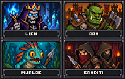
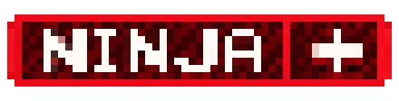
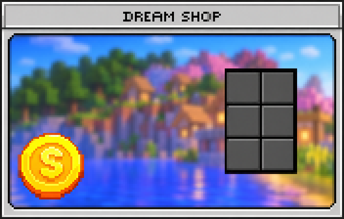
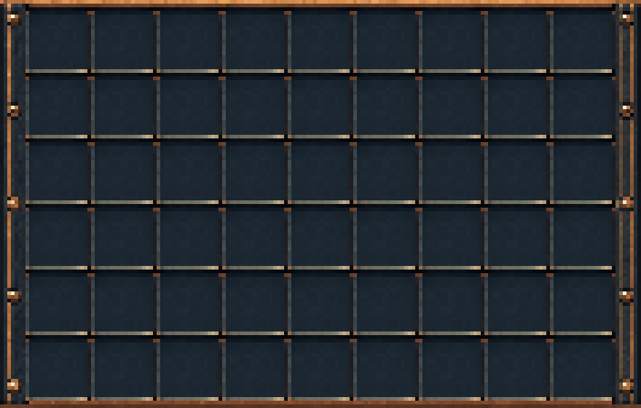
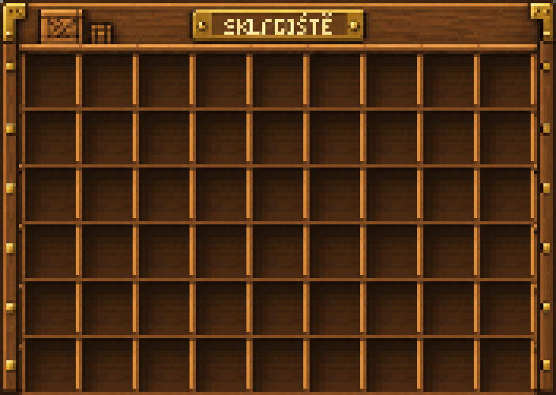
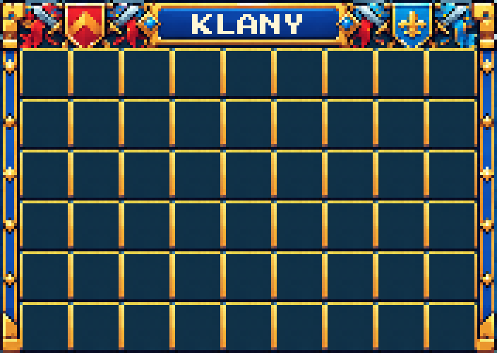

# Dungeons GUI

Grafika pro Minecraft GUI v rozměru **176 × 112 px**. Nahoře LICH a ORK, dole MURLOC a BANDITI.

- [Otevřít PNG](dungeons_gui_176x112.png)
- [Otevřít SVG](dungeons_gui_176x112.svg)

Pro stažení otevři soubor a použij tlačítko **Download raw file** vpravo nahoře.

## Rank NINJA — 55 × 14 px

Červená ranková ikonka vyplňuje celých **55 × 14 px** bez průhledného odsazení. Má vzorované pozadí, větší čitelný nápis **NINJA** a bílý latinský kříž s delší spodní částí vpravo.

Náhled výše je zvětšený pro snadné prohlížení. Pro použití ve hře stáhni originál:

- [PNG — originál 55 × 14 px](ninja_rank_55x14.png)
- [SVG — 55 × 14 px](ninja_rank_55x14.svg)
- [Zvětšený PNG náhled](ninja_rank_preview.png)

## DREAM SHOP — 176 × 112 px

Minecraft GUI vyplňuje celých **176 × 112 px**. Má šedý rámeček, horní lištu **DREAM SHOP**, rozostřené barevné pozadí, zlatou minci vlevo dole a šest slotů vpravo ve dvou sloupcích a třech řádcích.

- [PNG — originál 176 × 112 px](dream_shop_gui_176x112.png)
- [Zvětšený PNG náhled](dream_shop_gui_preview.png)

## SKLADIŠTĚ — 54 slotů, 176 × 112 px

Panel má přesně **176 × 112 px**, vyplňuje celou plochu a obsahuje **54 slotů v 6 řadách po 9**. Uvnitř obrázku není nadpis. Sloty mají rozteč **18 px** a vnitřní prostor **16 × 16 px** pro item.

Pro standardní souřadnice Minecraft menu se při měřítku **1:1** počítá umístění levého horního rohu obrázku na **(0, +15)** vzhledem k levému hornímu rohu menu. Skutečné zarovnání závisí na vykreslení v použitém menu/font pluginu; ve hře zatím nebylo ověřeno.

- [PNG — originál 176 × 112 px](skladiste_gui_176x112.png)
- [Zvětšený PNG náhled](skladiste_gui_preview.png)
- [Přesné souřadnice všech slotů (JSON)](skladiste_slot_layout.json)
- [Pokyny pro zarovnání v menu](skladiste_alignment.md)

## SKLADIŠTĚ s poličkami — horní panel 176 × 125 px

Horní panel zachovává **54 slotů v 6 řadách po 9** na standardních souřadnicích šablony. Dřevěné poličky tvoří rámečky slotů; hráčův inventář do obrázku není zahrnutý. Rozměr **176 × 125 px** odpovídá horní části šestiřadého chest menu: 17 px horní lišty a 108 px mřížky. Sloty mají přesnou rozteč **18 px** a prostor **16 × 16 px** pro každý item.

Nadpis **SKLADIŠTĚ** je vysázen ostrým pixelovým písmem s českými háčky. Poličky a souřadnice všech slotů zůstaly zachované.

- [PNG — horní panel 176 × 125 px](skladiste_policky_176x125.png)
- [Zvětšený PNG náhled](skladiste_policky_preview.png)
- [Přesné souřadnice slotů (JSON)](skladiste_policky_slot_layout.json)

Starší kompaktní varianta 176 × 112 px zůstává dostupná výše. Zarovnání nové varianty přímo ve hře zatím nebylo ověřeno.

Pro tuto variantu s horní lištou při standardním bitmapovém vykreslení použij `scale_ratio: 125`, `y_position: 13` a titulek `&f爩`. Cílem je vykreslení 1:1 s levým horním rohem obrázku na `(0, 0)` vůči menu. Hodnota `y_position` předpokládá přímé mapování na fontový ascent; skutečné zarovnání na serveru zatím nebylo ověřeno.

## KLANY — cartoon GUI 176 × 125 px

Barevné klanové GUI v modré, tyrkysové a zlaté barvě se štíty, prapory a ostrým pixelovým nadpisem **KLANY**. Obsahuje jen horní panel s **54 sloty v mřížce 9 × 6**, bez hráčova inventáře. Rozměr **176 × 125 px**, rozteč **18 px** a prostor **16 × 16 px** pro item zachovávají stejné souřadnice jako skladiště s poličkami.

- [PNG — originál 176 × 125 px](klany_gui_176x125.png)
- [Zvětšený PNG náhled](klany_gui_preview.png)
- [Přesné souřadnice slotů (JSON)](klany_slot_layout.json)

V ItemsAdder přiřaď novému obrázku vlastní fontový znak. Zarovnání přímo ve hře zatím nebylo ověřeno.
