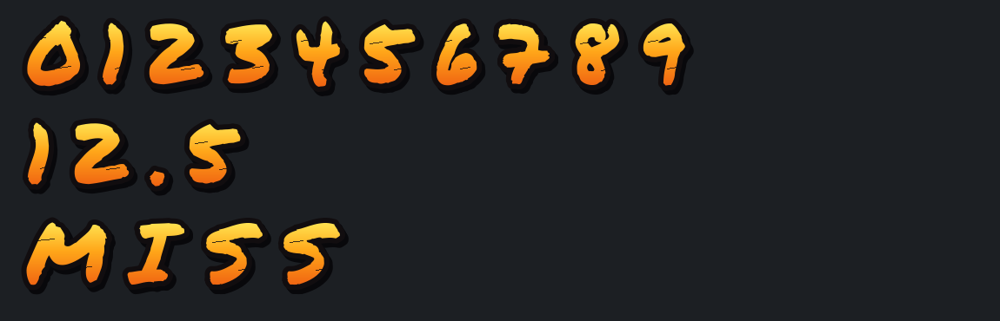

# OrangeDamageNumbers — Minecraft 1.20.4

**Stažení:** [Plugin JAR](releases/1.0.0/OrangeDamageNumbers-1.0.0.jar?raw=true)
· [Kompletní balíček s fontem a návodem](releases/1.0.0/OrangeDamageNumbers-1.0.0.zip?raw=true)
· [Resource pack](releases/1.0.0/OrangeDamageNumbers-resource-pack.zip?raw=true)
· [ItemsAdder — připravený ZIP](releases/1.0.0/OrangeDamageNumbers-ItemsAdder-1.0.0.zip?raw=true)
· [Bílé obdélníky? Oprava načítání fontu](docs/font-loading-fix.md)
· [Skrytí srdíček při zásahu](docs/no-hit-particles.md)

Plugin pro **Paper/Purpur 1.20.4, Java 17 nebo 21**. Vedle zasaženého hráče
se objeví poškození po započítání brnění a odolností. Číslo krátce vyletí
nahoru a zmizí. Nulový zásah zobrazí **MISS**. Štětcové číslice mají
oranžovožlutou výplň, silný černý obrys a stín; MISS používá stejný styl.



Není potřeba ProtocolLib, PlaceholderAPI ani ItemsAdder. Výchozí nastavení
zobrazuje poškození hráčů; volitelně lze zapnout také moby. Jde o Bukkit
plugin pro Paper/Purpur, nikoli o mod pro Forge/Fabric nebo plugin pro Folia.

## Instalace

1. Vypni server a vlož `dist/OrangeDamageNumbers-1.0.0.jar` do `plugins/`.
2. Spusť server. Vznikne `plugins/OrangeDamageNumbers/config.yml` a kopie
   dodaného ZIPu resource packu. Plugin funguje i bez packu, s běžnými
   oranžovými číslicemi a stínem.
3. Pro štětcový font zvol jednu z možností níže. Potom otestuj `/dn test 12.5`
   a `/dn test 0`.

### Vlastní samostatný resource pack

Nahraj `dist/OrangeDamageNumbers-resource-pack.zip` na adresu s přímým
stažením. V `plugins/OrangeDamageNumbers/config.yml` nastav:

```yaml
resource-pack:
  url: 'https://tvoje-domena.cz/OrangeDamageNumbers-resource-pack.zip'
  sha1: '40f68175beec7e3b0738a9691c7332ef6a866e09'
  required: false
  prompt: 'Oranžová čísla poškození a MISS'
```

Adresa výše je příklad: nahraď ji skutečnou adresou ZIPu. SHA-1 patří
přibalenému ZIPu; po přegenerování zkontroluj
`dist/OrangeDamageNumbers-resource-pack.sha1`. Po sloučení nebo jiné změně
ZIPu spočítej SHA-1 výsledného souboru.

Spusť `/dn reload` a potvrď načtení packu v klientu. Plugin vlastní pack
přidává s vlastním UUID k ostatním packům a používá jeho font až po potvrzení
úspěšného načtení. Hráči, kteří pack odmítnou, uvidí běžné oranžové písmo,
pokud `required` zůstane `false`.

### Už používáš ItemsAdder nebo jiný serverový pack

Pro ItemsAdder je připravený [ZIP pro přímé rozbalení](releases/1.0.0/OrangeDamageNumbers-ItemsAdder-1.0.0.zip?raw=true).
Rozbal jej do kořene serveru, spusť `/iazip`, načti aktualizovaný pack a použij
`/dn reload`. Obsahuje i přednastavený config DamageNumbers; pokud si chceš
zachovat vlastní nastavení, viz [pokyny k balíčku](docs/itemsadder.md).

Do svého výsledného packu přidej `assets/orange_damage/` z dodaného ZIPu,
spolu s jeho licencí a souborem `FONT-NOTICE.txt`. **Nepřepisuj** metadata
celého packu ani `assets/minecraft/font/default.json`. Detaily:
[integrace fontu](docs/font-pack.md).

Jakmile ověříš, že klienti skutečně načetli sloučený pack, nastav:

```yaml
font:
  assume-installed: true
resource-pack:
  url: ''
  sha1: ''
```

Tento režim spoléhá na doručování tvého stávajícího packu. Plugin nemůže
sám ověřit obsah packu jiného pluginu. Zapni jej až po ověření distribuce;
jinak mohou hráči bez packu vidět chybějící znaky. Alternativně můžeš ponechat
vypnutý `assume-installed` a nechat náš plugin nabídnout vlastní pack.

## Příkazy

Vyžadují oprávnění **`damagenumbers.admin`**, standardně je mají operátoři.
Samotné zobrazování poškození žádné oprávnění nevyžaduje.

| Příkaz | Chování |
| --- | --- |
| `/dn test 12.5` | Ukáže zkušební číslo vedle tebe, bez poškození hráče. |
| `/dn test 0` | Ukáže zkušební MISS. |
| `/dn reload` | Načte konfiguraci, uklidí staré efekty a nabídne nastavený pack. |
| `/dn pack` | Znovu ti nabídne nakonfigurovaný pack. |

Plný název příkazu je `/damagenumbers`.

## Nastavení efektu

Výchozí konfigurace je v
[`src/main/resources/config.yml`](src/main/resources/config.yml).

- `animation.scale`: velikost čísel ve světě. Výchozí `1.0`; pro menší efekt
  zkus `0.75`. Není potřeba zmenšovat zdrojové PNG fontu.
- `animation.lifetime-ticks`: délka zobrazení; výchozích 24 ticků je 1,2 s
  při 20 TPS.
- `animation.side-offset`, `height-offset`, `rise-blocks`: umístění vedle
  hráče a výška animace v blocích.
- `animation.viewer-range`: kdo číslo uvidí; výchozí vzdálenost 24 bloků.
- `animation.max-active`: maximálně 80 současných efektů, každý má nejvýše
  dvě display entity pro různé fonty diváků. Nejstarší efekty se uvolňují.
- `targets.mobs: true`: zapne i jiné živé entity.
- `targets.combat-only: true`: omezí efekt na poškození od entity, včetně
  projektilů; vypne čísla za pád, oheň apod.
- `numbers.hearts: true`: čísla v srdíčkách. Standardně jde o damage body,
  takže **2 damage = 1 srdíčko**.
- `numbers.decimals`: 0–2 desetinná místa, výchozí 1. Skutečně kladné malé
  poškození se nikdy nezmění na MISS; při zaokrouhlení na nulu se zobrazí
  nejmenší kladná hodnota pro zvolenou přesnost.
- `numbers.show-miss: false`: vypne nulové zásahy.

Efekt používá skutečnou událost poškození a nemění její výsledek. **MISS
znamená nezrušený zásah, jehož výsledné poškození je nula.** Mávnutí do
vzduchu bez zásahu entity nemá damage událost; zásahy zrušené ochranou
regionu nebo jiným pluginem se nezobrazují. Číslo odpovídá hodnotě
`getFinalDamage()`, nikoli rozdílu zdraví omezenému zbývajícími životy.

Poškození je vidět okolním hráčům, kteří vidí zasaženého hráče. Číslo zůstává
v místě zásahu a mírně stoupá. Při vypnutí nebo reloadu se odstraní; do světa
se neukládá. Čísla se vykreslují s ohledem na překážky.

## Sestavení ze zdrojů

Potřebuješ JDK 17+ (včetně `javac`), Maven 3.9+ a Python 3.10+ s Pillow.

```sh
cd damage-numbers
python3 -m venv .venv
. .venv/bin/activate
python3 -m pip install -r tools/requirements-font.txt
sh build.sh
```

`build.sh` obnoví font, ověří assety, spustí Java testy a sestaví JAR.
Výsledky jsou v `dist/`. Plugin závisí na Paper API pouze při kompilaci;
API a Adventure poskytuje server, nevkládají se do JARu. Samostatná kontrola
Java testů po vytvoření packu: `mvn test`.

Font **Permanent Marker** má licenci Apache 2.0. Originál, licence, zdroj a
kontrolní součet jsou v `tools/font/`; licence je i uvnitř resource packu.
